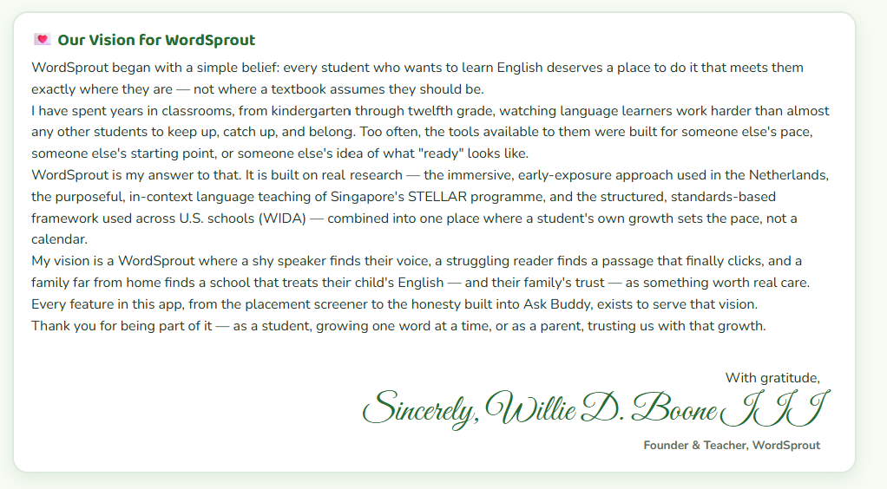
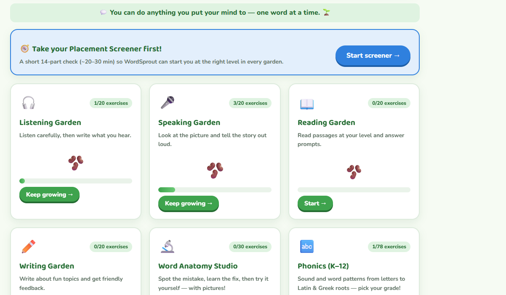
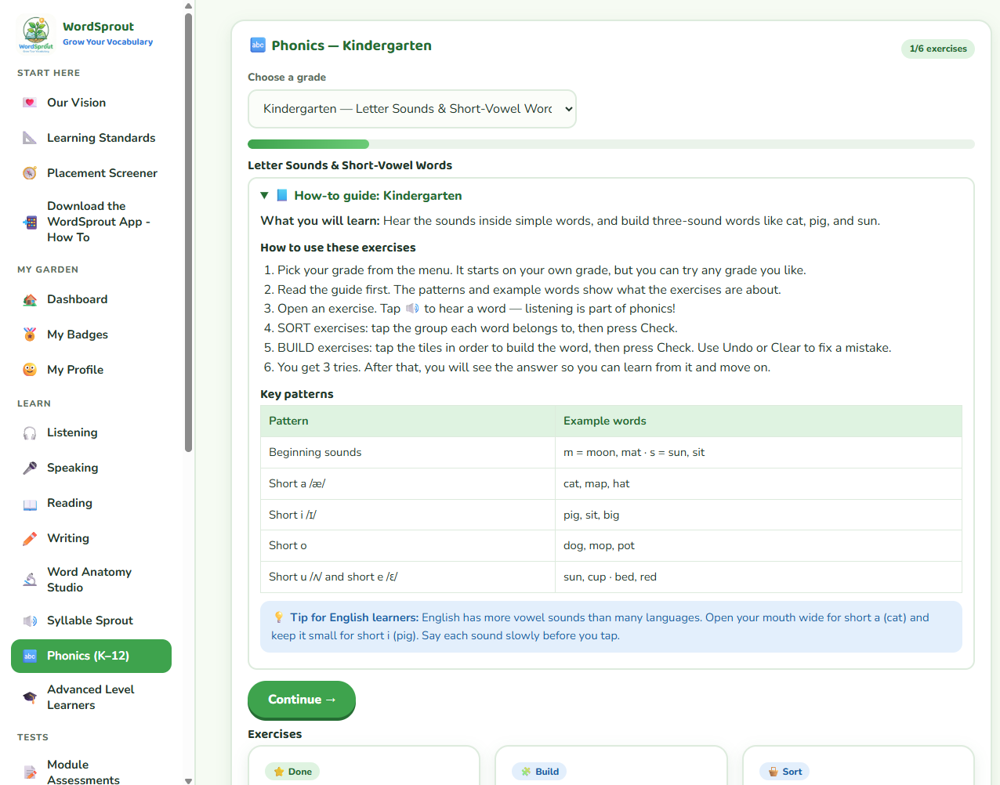
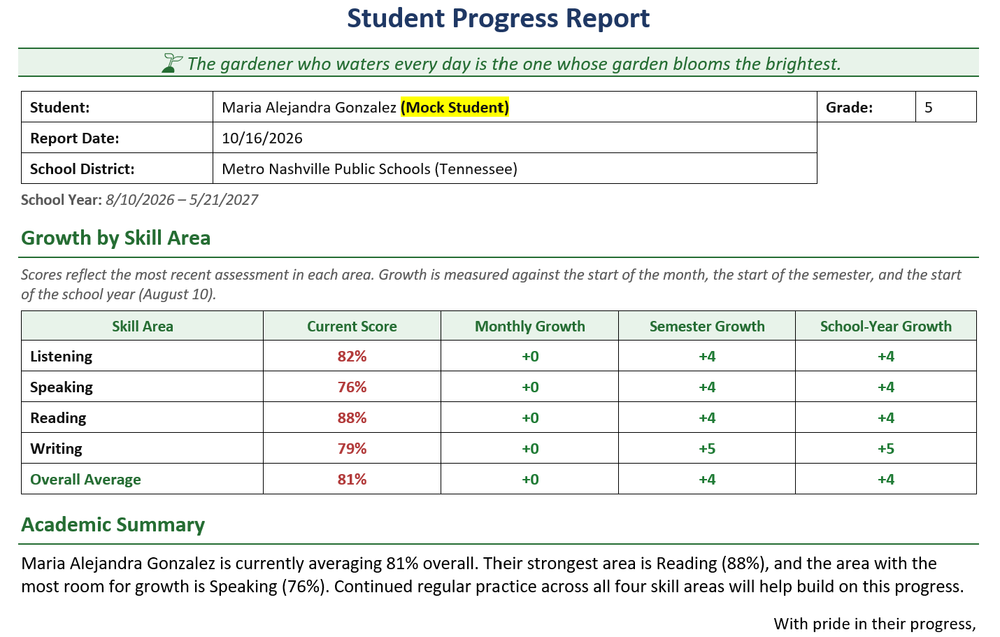

# 🌱 WordSprout — Grow Your Vocabulary

A web-based tutoring platform for K–12 English Language Learners (ELLs). Students learn vocabulary, listening, speaking, reading, writing, and now phonics, with an AI study buddy, text-to-speech, progress tracking, and an admin dashboard for the teacher.

Built by Willie D. Boone III (M.Ed. in ESL, M.S. in Applied Artificial Intelligence) as a working product and a portfolio project. Created July 23, 2026. Currently used by a small pilot group of students.

**Live demo:** https://wdboone.github.io/wordsprout-english-language-learning-platform-k12/

_The app requires sign-in because it stores student progress. Create a free test account on the login screen to explore it._

## Screenshots



| Dashboard | Phonics (K–12) |
|---|---|
|  |  |



## Why this exists

Many ELLs need practice that adapts to their level and language background, and many tutoring tools are either too expensive or are not built for English language learners. WordSprout combines classroom ESL teaching practice with modern AI tools: short, scaffolded exercises, audio support, and a teacher view of every student's progress.

## Features

| Area | What it does |
|---|---|
| **Learn modules** | Word Anatomy Studio, Syllable Sprout, and **Phonics (K–12)** |
| **Phonics (K–12)** | A how-to guide plus 6 exercises for each of 13 grades (K–12), 78 in total. Grades K–8 build decoding and spelling skills; grades 9–12 cover morphology and academic vocabulary (Latin and Greek roots, word families). Two exercise types: **sort** (tap the group a word belongs to) and **build** (tap tiles in order). |
| **Skills practice** | Listening, speaking, reading, and writing activities, with assessments |
| **Ask Buddy** | An AI study helper powered by the Anthropic API |
| **Audio** | Text-to-speech through ElevenLabs on exercises that use `speak()`. Speaking practice uses the browser's built-in speech recognition, so speech is turned into text on the student's device and no audio is recorded or stored. |
| **Progress and badges** | Star-based progress per module, a dashboard, scores stored per student, and downloadable progress reports |
| **Admin tools** | Teacher dashboard, student folders, analytics, messages, homework review, student data deletion, and a "preview as student" mode |
| **Messages** | Students message the teacher, receive replies in the app, and can answer any teacher message with a **Reply** button. A bar at the top of every screen, plus a dot beside **Meet Your Teacher**, tells a student when a new message from the teacher is waiting. |
| **Accounts and consent** | Email and password sign-in, and a parental consent flow for students under 13 |
| **Bilingual interface** | English and Spanish for key screens, including the privacy and consent notices |

## Tech stack

- **Frontend:** a single-file vanilla HTML, CSS, and JavaScript app (no build step), hosted on **GitHub Pages**
- **Backend:** **Supabase** (Auth, Postgres, Row Level Security, Storage, Edge Functions)
- **AI:** Anthropic API (called from an Edge Function, `ask-buddy`, so keys never reach the browser)
- **Text-to-speech:** ElevenLabs (called through a server-side function, `text-to-speech`)
- **Email:** Resend (confirmation and password-reset emails)
- **File storage:** Supabase Storage private buckets (homework, consent forms, and admin assets), read through short-lived signed URLs or access policies
- **Images:** the exercise photos in photos/ were generated with Google Gemini; the repository contains no photos of real students
- **Source control:** GitHub

### Architecture at a glance

```
Browser (GitHub Pages, index.html)
   │  supabase-js (publishable key + user session)
   ▼
Supabase ── Auth ── Postgres (RLS: students see only their own rows)
   ├──── Storage (private buckets + access policies)
   └──── Edge Functions ── Anthropic API / ElevenLabs   (secret keys live here only)
```

## Design decisions and trade-offs

- **Single-file frontend.** It is simple to deploy and easy to reason about, but the file is large and has no module boundaries. A future step is splitting it into modules with a bundler.
- **Security lives on the server.** The page is public, so anything in it is visible to anyone. Real protection comes from Row Level Security in Postgres, Storage access policies, and secrets kept in Edge Functions, never from hiding things in client code.
- **Sensitive files stay out of the repository.** The administrator's signature and the payment QR code and tag live in private Storage buckets. The app fetches them only for signed-in users (the signature for the admin only), so they are never in the public source.
- **Speech stays in the browser.** Speaking exercises use the browser's speech recognition and save only the resulting text. ElevenLabs receives lesson text only, never student recordings.
- **Phonics progress is isolated.** Phonics saves in its own database request, so a missing column can never block saving a student's other progress. Progress is also stored in the browser (`localStorage`) and merged with the database copy, so stars survive even when the database is unavailable.
- **Separate columns per module.** Each module owns its own JSON column (for example `progress.phonics`) rather than sharing one, which keeps data easy to inspect and migrate.
- **New-message indicator without a push service.** The app checks for unread teacher messages at sign-in, every 60 seconds, and when the tab regains focus. "Seen" is the timestamp of the newest teacher message the student has opened, stored in the browser and, when the optional `messages_seen_at` column exists, on the account. It works without the column and without realtime infrastructure; realtime push is a possible upgrade.
- **Honest login errors.** The login screen reports the real failure (wrong password versus server unreachable) instead of one generic message.

## Phonics content design

- Complexity rises by grade: K short vowels and CVC words; 1 digraphs, blends, silent e; 2 vowel teams; 3 r-controlled vowels and diphthongs; 4 syllable types and compound words; 5 prefixes and suffixes; 6 soft c/g and silent letters; 7 suffix spelling rules; 8 multisyllable words, stress, and schwa; 9 academic prefixes and suffixes; 10 Latin roots; 11 Greek roots; 12 academic word families.
- Each grade guide includes pronunciation tips for ELLs (for example, the English *th* and *r* sounds).
- Learners get 3 tries, then see the answer; the ⭐ is awarded only for full success.
- The exercise data is plain JavaScript arrays, validated by script (every build target is formable from its tiles; every sort item has a valid group).

## Running and deploying

**Local:** open `index.html` in a browser. Sign-in needs the Supabase project to be running.

**Deploy:** commit `index.html` to the repository's main branch (the GitHub website's **Add file, Upload files** works). GitHub Pages rebuilds in a minute or two.

**Database setup for Phonics (one time):** run `migration_phonics.sql` in the Supabase SQL Editor. It adds a `phonics` JSON column to `public.progress`. The app works without it (progress stays in the browser), but the column enables syncing across devices.

**Database setup for the new-message indicator (optional, one time):** run `migration_messages_seen.sql` in the Supabase SQL Editor. It adds a `messages_seen_at` column to `public.profiles` so "seen" follows a student across devices. Without it, the indicator still works but remembers per browser.

> Supabase's SQL Editor no longer saves snippets automatically. Click **Save** (or press Ctrl+S) if you want to keep a query.

## Operations notes

- **Free-tier pausing.** Supabase pauses Free projects after about a week of inactivity, and a paused project makes every login fail. This happened once during development. Options: upgrade to Pro, or schedule a lightweight keep-alive request.
- **Backups.** Download database and storage backups from the dashboard, and keep them outside the repository. The `.gitignore` in this repo excludes `.env` files, keys, and backup files.

## Privacy and safety

WordSprout stores student information, including children's data. It includes a parental-consent flow for students under 13 and a bilingual (English and Spanish) privacy notice written with COPPA in mind. It does not record or store student audio, ElevenLabs receives lesson text only, and the admin can delete a student's data. Keep backups private, never commit keys, and keep Row Level Security enabled on every table.

## Roadmap

- Client-side error logging (`error_log` table)
- Real email notifications to the admin for new messages (Edge Function plus Resend with a verified sending domain). Today, contact messages are saved in the app and shown in the Admin Panel.
- Split the single file into modules
- More Phonics content and teacher-editable word lists
- Phonics sound support: tap a letter to hear its sound, and hear the word read aloud after a correct build
- Keep-alive or Pro plan for steady uptime

## License

All rights reserved. The source is public for review and evaluation. Please contact the author before reusing it.

## Author

**Willie D. Boone III**: educator turned AI engineer. M.Ed. (ESL) and M.S. in Applied Artificial Intelligence. GitHub: [wdboone](https://github.com/wdboone). Skills shown in this project: full-stack development, Postgres and RLS, LLM integration, instructional design for ELLs.
